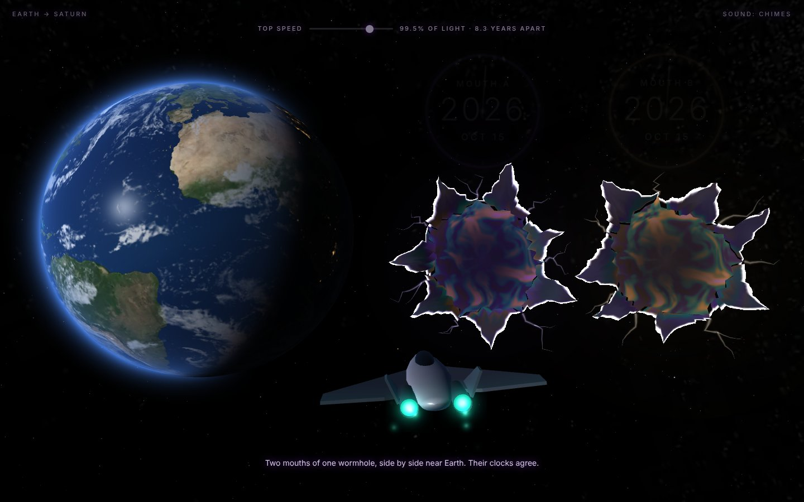

# Wormhole

A small ship leaves Earth, tears space open, flies through a wormhole and
comes out at Saturn. One HTML file with three.js; the Earth, the stars and
the Milky Way are the real ones.

**Run it:** open `index.html` in a browser. It loads three.js from a CDN,
so it needs a network connection the first time.

Tap or click to start the trip. Steer with the mouse, a finger, the arrow
keys or WASD. The button in the top right switches the sound between
chimes, hum and off. All sound is made in the page; nothing is recorded.

Where the pictures and star data come from is in [CREDITS.md](CREDITS.md).

## Licence

The code is under the [MIT licence](LICENSE). The maps and star data packed
inside the page keep their own terms (public domain, or free with credit);
see [CREDITS.md](CREDITS.md).

Made by w00l23, with help from Claude (Anthropic).
